# Winali

Una tienda de aplicaciones Android sencilla: descubre, instala y actualiza apps publicadas en GitHub. Sin cuentas, sin anuncios, sin telemetría y sin backend propio. Todo (código, catálogo y descargas) vive en GitHub.

## Descargar

**[⬇ Descargar Winali (APK, última versión)](https://github.com/WillianChavez/winali/releases/latest/download/winali.apk)**

Todas las versiones: [Releases](https://github.com/WillianChavez/winali/releases). Requiere Android 8.0 o superior.

1. Descarga el APK desde el enlace anterior.
2. Ábrelo y, si Android lo pide, permite instalar desde tu navegador o gestor de archivos.
3. Abre Winali, elige una app e instálala. Android te pedirá confirmar cada instalación.

Comprueba la integridad si quieres: el SHA-256 del APK y la huella del certificado de firma están en [`catalog/index.json`](catalog/index.json).

### Si Google Play Protect bloquea la instalación

Play Protect desconfía de apps de desarrolladores independientes que instalan otras apps. Winali no puede (ni debe) saltarse esa protección, pero puedes continuar tú mismo:

- Cuando aparezca el aviso, toca **Más detalles → Instalar de todos modos**.
- Si dice "Bloqueada por Play Protect" sin esa opción: Play Store → tu perfil → **Play Protect → Ajustes** y desactiva temporalmente *Analizar apps con Play Protect* mientras instalas; vuélvelo a activar después.
- Winali declara el origen de la instalación como tienda y verifica hash, paquete, versión y certificado antes de entregar el APK a Android. Todo el código es abierto y auditable.
- La alerta suele desaparecer con el tiempo, a medida que Google reconoce la firma estable de cada app. Mantener siempre la misma clave de firma es lo que lo permite.

## Capturas

| Winali | Ficha | Ajustes |
|---|---|---|
| 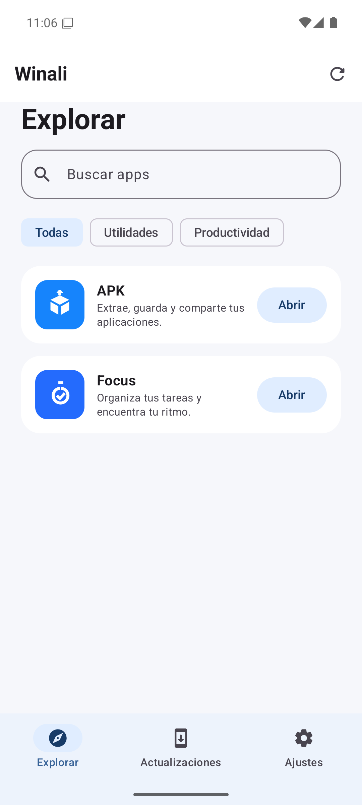 | 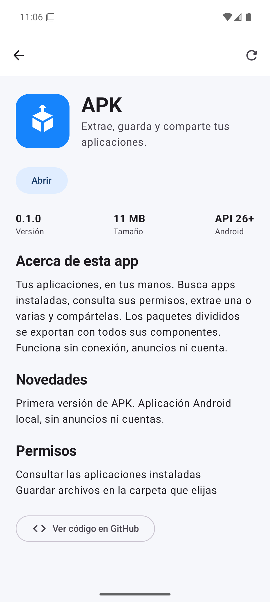 | 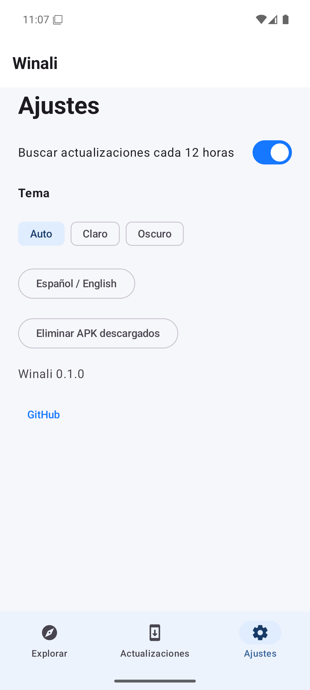 |

| APK | Extracción múltiple |
|---|---|
| 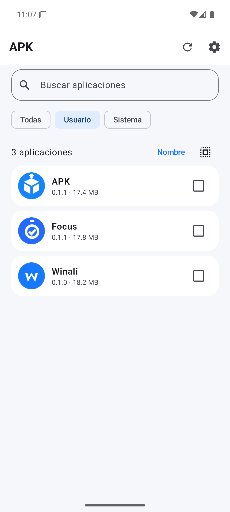 | 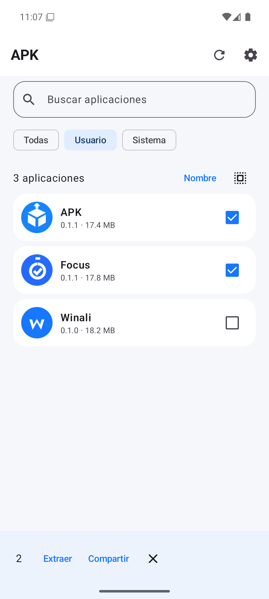 |

| Tareas | Temporizador | Reportes | Bosque |
|---|---|---|---|
| 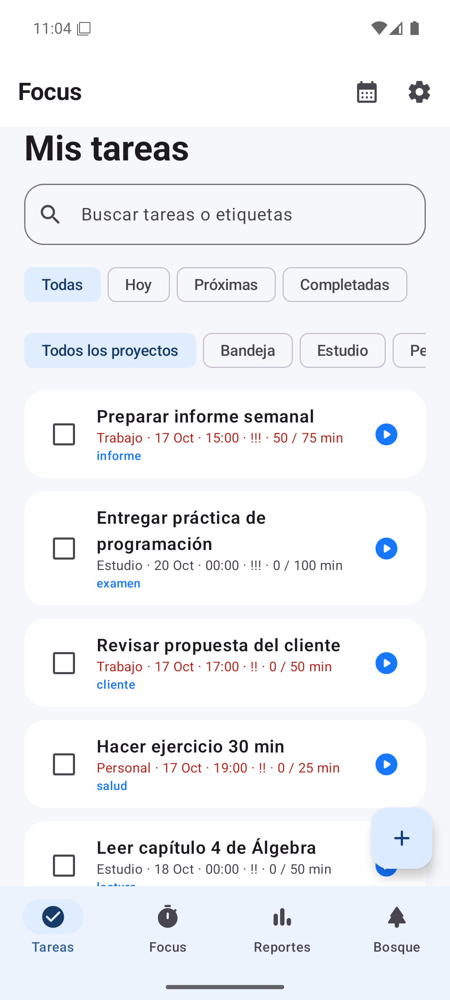 | 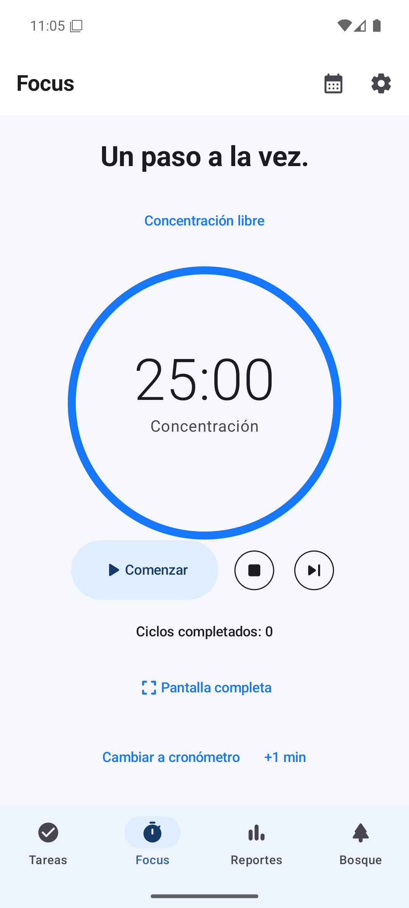 | 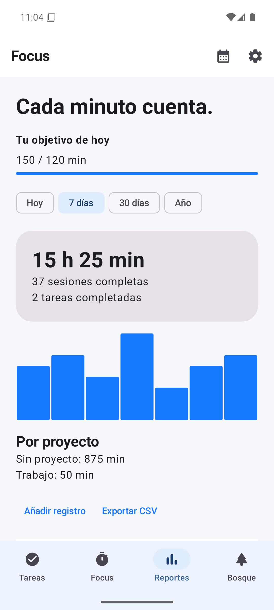 | 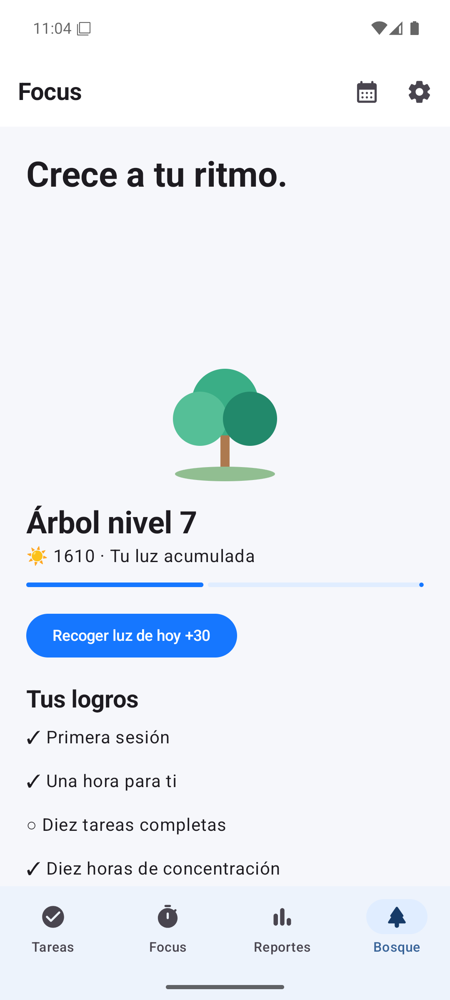 |

| Read |
|---|
| 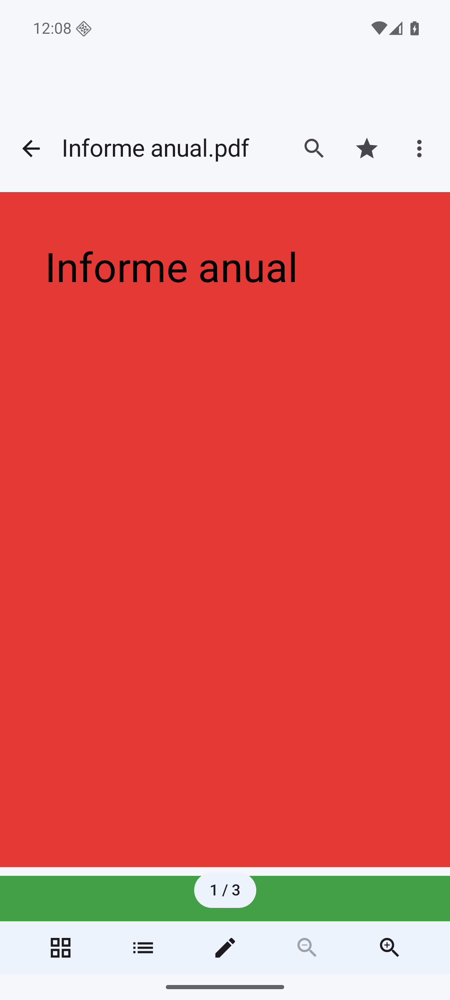 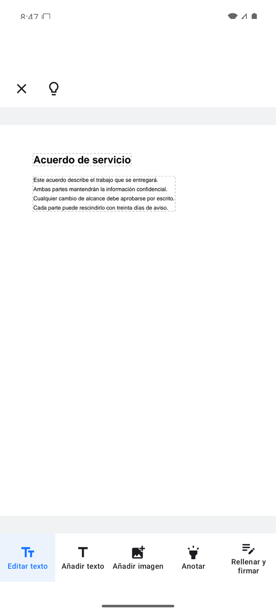 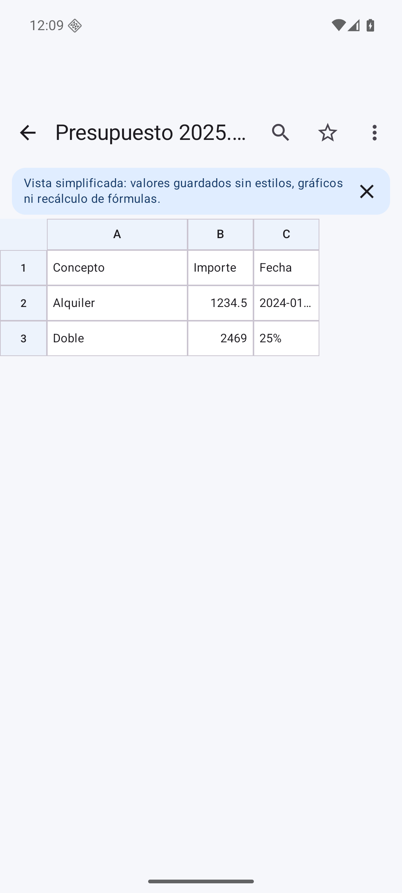 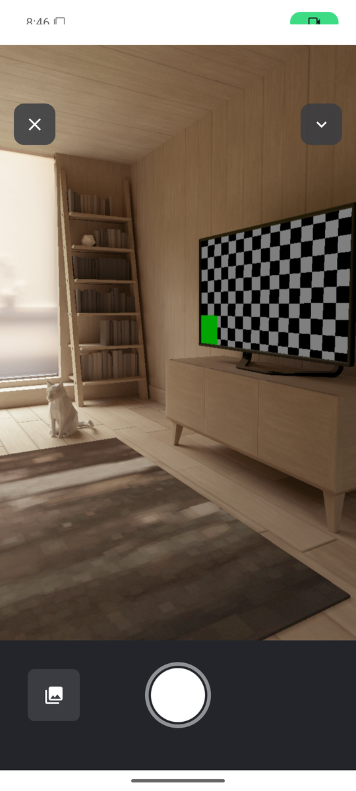 |

## Actualizaciones

- Winali consulta el catálogo al abrir y cada ~12 horas en segundo plano, y puedes actualizarlo a mano.
- La pestaña **Actualizaciones** muestra las versiones nuevas; nada se descarga sin que lo pidas.
- **Winali se actualiza a sí misma** con el mismo mecanismo: figura en el catálogo y, cuando hay una versión nueva, aparece como cualquier otra app.
- Una actualización solo se instala si el paquete coincide, el `versionCode` es mayor y el certificado es el mismo, por lo que nunca se pierden los datos.

## Aplicaciones disponibles

| App | Qué hace | Repositorio | Descarga |
|---|---|---|---|
| **Winali** | La tienda | [winali](https://github.com/WillianChavez/winali) | [winali.apk](https://github.com/WillianChavez/winali/releases/latest/download/winali.apk) |
| **APK** | Extrae, guarda y comparte tus apps (con paquetes divididos), sin Internet | [apk](https://github.com/WillianChavez/apk) | [apk.apk](https://github.com/WillianChavez/apk/releases/latest/download/apk.apk) |
| **Focus** | Tareas, Pomodoro, calendario, reportes y bosque; datos solo en tu teléfono | [focus](https://github.com/WillianChavez/focus) | [focus.apk](https://github.com/WillianChavez/focus/releases/latest/download/focus.apk) |
| **Read** | Lector y editor de documentos: PDF, Word, Excel, PowerPoint y OpenDocument; edita texto de PDF, añade imágenes, firma, convierte y escanea; sin Internet | [read](https://github.com/WillianChavez/read) | [read.apk](https://github.com/WillianChavez/read/releases/latest/download/read.apk) |

Identificadores: `io.github.willianchavez.winali`, `.apk`, `.focus`, `.read`. Cada app tiene su propia clave de firma.

## Cómo funciona

- Un único documento público, [`catalog/index.json`](catalog/index.json) (`schemaVersion: 1`, esquema en [`catalog/schema.json`](catalog/schema.json)), describe las apps. Los teléfonos no consultan la API de GitHub.
- Winali guarda la última copia válida para navegar sin conexión y rechaza catálogos más antiguos que el que ya tiene.
- Las descargas se encolan con progreso, cancelación independiente y reintento.
- Solo se instalan APK únicos. Los paquetes divididos y AAB quedan fuera de la v1.
- Estándar completo: [docs/CATALOG.md](docs/CATALOG.md).

## Añadir o publicar una app

Cada app vive en su repositorio (de cualquier propietario) y publica una GitHub Release con su APK firmado y un `release.json` generado desde el APK real.

1. Compila y firma el APK con una clave propia y estable.
2. Crea la Release con `app.apk` y `release.json`.
3. En este repositorio, añade la ficha en `catalog/index.json` (primera vez) y ejecuta `node tools/catalog.mjs sync <id>`.
4. Revisa el cambio y haz commit. No hace falta recompilar la tienda: los teléfonos ven la novedad en su próxima comprobación.

Si el repositorio no genera `release.json`, usa `node tools/release-manifest.mjs` sobre su APK publicado y revisa los datos antes de incluirlos. Winali no tiene pantallas para subir apps, administrar repositorios ni iniciar sesión.

## Desarrollo

Requisitos: JDK 21, Android SDK con plataforma 36 y Build Tools 36.0.0, Node 22. Define `JAVA_HOME` y `ANDROID_HOME`, o crea `local.properties` con `sdk.dir`.

```sh
./gradlew :app:assembleDebug :app:testDebugUnitTest :app:lintDebug
./gradlew :app:connectedDebugAndroidTest   # emulador o dispositivo
node --test tools/catalog.test.mjs
node tools/catalog.mjs validate
```

El código de APK y Focus vive en sus propios repositorios (en local, en `apps/apk` y `apps/focus`, ignorados por este repositorio).

### Firma de versiones

Las Releases se firman en GitHub Actions con la clave del repositorio. Configura los secretos `SIGNING_KEYSTORE_BASE64`, `SIGNING_STORE_PASSWORD` y `SIGNING_KEY_PASSWORD` (alias `release`). Guarda una copia privada de la clave: si se pierde, los usuarios no podrán actualizar. Nada de esto se incluye en Git.

## Estado

Seguimiento de lo implementado y verificado: [docs/IMPLEMENTATION.md](docs/IMPLEMENTATION.md).

## Licencia

MIT. Winali y sus iconos son originales; no se incluye material de aplicaciones de terceros.
